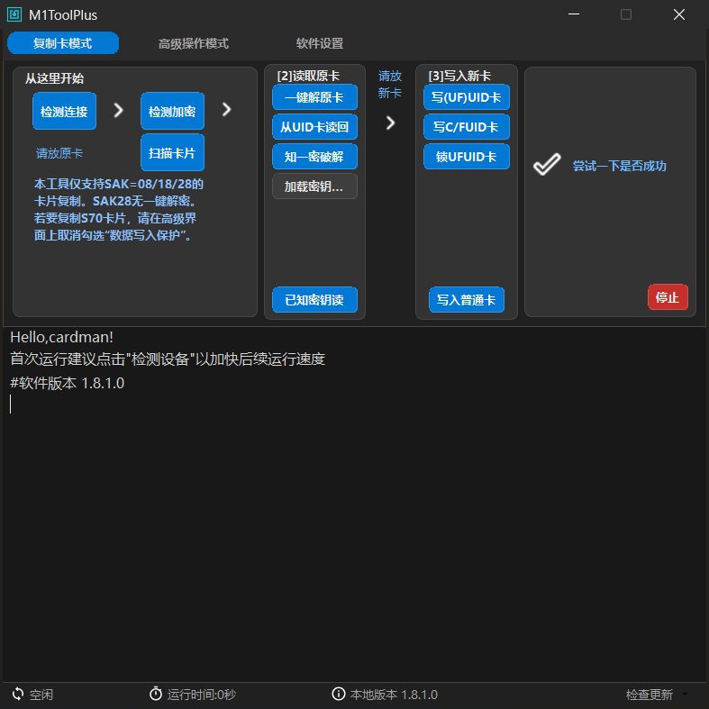
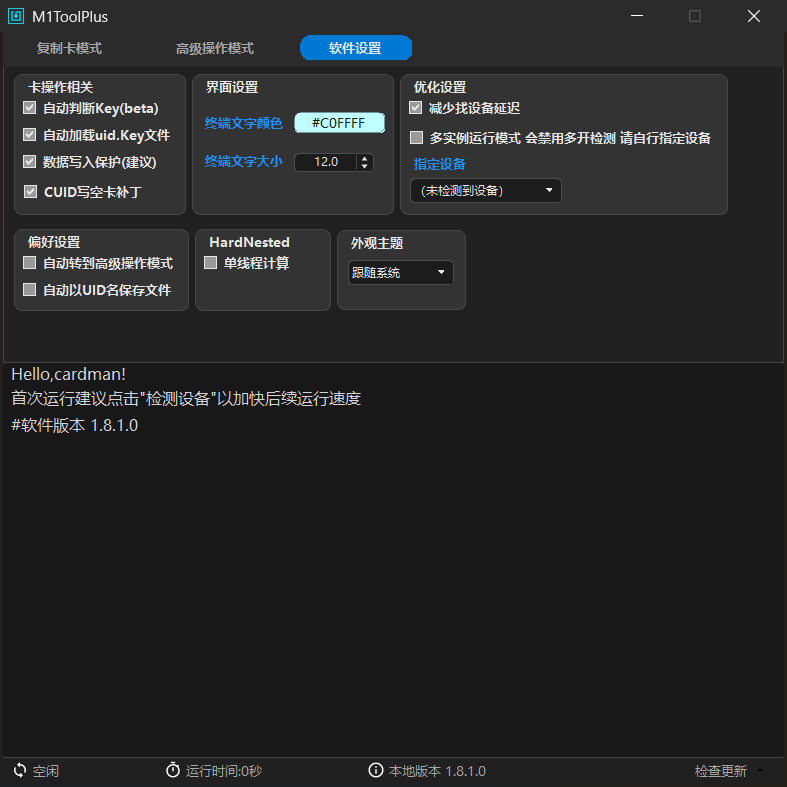

<h1>M1ToolPlus</h1>

<b>把 libnfc 的一整套命令行工具，装进一个看得懂的窗口</b> 
MIFARE Classic（M1 卡）读写 / 复制 / 密钥恢复 · Windows 桌面 · GPL-3.0

  
  

  
  
  
  
  

<a href="#这个版本有什么不同">版本差异</a> ·
<a href="#功能一览">功能</a> ·
<a href="#支持的设备与卡型">设备与卡型</a> ·
<a href="#下载与运行">下载运行</a> ·
<a href="#常见问题">常见问题</a> ·
<a href="#文档">文档</a>

  
   
  复制卡模式：检测 → 扫描 → 解密 → 读 → 写，四张卡按顺序点下去就行

M1ToolPlus 是 [MifareOneTool](https://github.com/xcicode/MifareOneTool) 的社区延续版。原作者 2019 年后停更，
本仓库接着维护：把 libnfc 那一组命令行工具（nfc-list、nfc-mfclassic、mfoc、mfcuk、hardnested……）
包成单窗口向导，读卡写卡不用再背参数。

需要精细控制时切到「高级操作模式」，全部功能按钮平铺；主题、终端、设备参数都在「软件设置」页。

---

## 这个版本有什么不同

- ✅ **修掉老问题** —— 终端中文乱码、S50HTool 浅底浅字、DiffTool 窗口被撑成 900×640、
  Win10 下检测设备要等 100 秒，这些在本版都已处理。
- 🎨 **界面重做** —— 浅色 / 深色主题跟随系统即时切换，卡片式布局，窗口固定 787×787；
  100% / 125% / 150% 缩放按物理像素 1:1 绘制，文字不发虚。
- 🧹 **只保留简体中文** —— 移除英文、俄文资源与语言切换项，包体更小，界面不再出现半中半英。
- 🔄 **检查更新** —— 状态栏右下角直连本仓库 Release，下载包附 SHA256 校验，
  同尺寸篡改会被拒绝。
- 🩹 **救砖** —— 内置 MFF08 修复，能把写卡失败弄坏的 0 块（UID 块）写回去。
- 📚 **文档齐全** —— 中文应用手册、排障手册、开发与测试说明，见[文档](#文档)。

## 功能一览

### 读卡 / 写卡 / 管理

| 功能 | 说明 |
|---|---|
| **检测设备** | 检测读卡器连接状态，启动后第一步（首次运行先做，可加快后续操作） |
| **手动扫描** | 扫描卡片并显示基本信息（UID、SAK、ATQA 等） |
| **读 M1 / 写 M1** | 读写普通 M1 数据；默认密钥卡可直接读写，非默认密钥需指定密钥文件 |
| **清 M1** | 用选中的密钥文件清空卡内全部数据 |
| **选择 key.mfd** | 指定密钥文件；也可启用「自动加载 uid.Key 文件」按卡号自动匹配 |
| **检加密** | 查看各扇区加密情况，判断该用哪种方案 |
| **差异比较** | 对比两个 dump 的扇区差异，快速定位改动 |
| **Hex 编辑器** | 内置 S50HTool，查看/编辑 dump，所见即所得 |

### 密钥破解与恢复

| 功能 | 说明 |
|---|---|
| **MFOC** | 半加密卡（常见 SAK=08）Nested 攻击恢复密钥；**按住 Ctrl 点击**可附加已知密钥 |
| **知 n 密 / 字典测试** | 已知部分密钥时定向补全其余扇区；字典方式批量试探 |
| **全加密爆破** | 调用 MFCUK 对全加密卡做 Darkside 攻击 |
| **HardNested** | 独立窗口执行 hardnested 攻击，含「低成本」「单线程」计算开关 |

### 魔改卡（UID / CUID / FUID / UFUID）

| 功能 | 说明 |
|---|---|
| **UID 读 / UID 写** | 后门指令直读直写，无视扇区密钥（需魔改卡） |
| **UID 写号 / UID 重置** | 把 UID 改成指定号码，或重置为随机数 |
| **UID 全格** | 重置 UID 并清空全部扇区、恢复出厂访问控制位 |
| **CUID 写** | 用普通指令写 0 块（CUID 卡），配合「CUID 写空卡补丁」处理空卡 |
| **锁 Ufuid** | 锁定 UFUID 的 0 扇区，锁定后不可再写 —— 定版收尾用 |

### 救砖：MFF08 CUID 修复

写卡失败把卡片 **0 块（UID 块）写坏**后，卡会变砖：读卡器认不出、密钥校验全部失效。
「MFF08」对话框可把全空的出厂数据直写回 0 块救活卡片，两种修复方式：

| 方式 | 适用场景 |
|---|---|
| **A** | 卡仍是全 F 出厂密钥时，直接写回 |
| **C** | 用「最后一次写坏这张卡时保存的 dump」里的密钥写回 |

> 仅对可写 0 块的 CUID / Gen1a 类魔改卡有效；正版卡 0 块只读，不会被此操作碰到。

### 通用工具与界面体验

| 项目 | 说明 |
|---|---|
| **CLI** | 打开命令行并定位到 `nfc-bin\`，可直接调用 libnfc 等工具 |
| **清终端** | 清空终端视图 |
| **存日志** | 终端内容存为 `m1t.log`（UTF-8） |
| **停止** | 强行终止正在执行的操作 |
| **主题** | 「外观主题」组：跟随系统 / 深色 / 浅色，即时生效 |
| **终端** | 「界面设置」组：字体族、字号（默认 12 pt）、颜色 |
| **高 DPI** | 100% / 125% / 150% 下按物理像素 1:1 绘制，不随缩放拉伸 |

主题切换会同步到配置、差异比较、Hex 编辑、MFF08 修复等子窗口；终端内
**Ctrl+滚轮** 可缩放字号，与设置页联动，点「终端文字颜色」的色块可直接换色。

  
   
  软件设置页：外观主题、终端配色与字号、设备参数

## 支持的设备与卡型

| 读卡器 | 说明 |
|---|---|
| **PN532（串口 / USB-TTL）** | 推荐，兼容性最好。板载串口芯片建议 CH340/CH341；PL2303 部分系统不稳定，CP2104 不可用 |
| **ACR122U（USB）** | 支持但**默认关闭**，需在设置页手动启用（启用后部分操作会变慢） |

> 串口驱动请自备（沁恒官网下载 CH340 驱动），不随包分发。

卡型速查（完整矩阵见[应用手册 §2](docs/USERGUIDE.md)）：

| 卡型 | 读写 | 一键解密 | 魔改操作 | 说明 |
|---|:---:|:---:|:---:|---|
| **S50 1K**（SAK=08） | ✅ | ✅ | ❌ | 全功能，最常见的门禁卡 |
| **S70 4K**（SAK=18） | ⚠️ 写需关保护 | ❌ | ❌ | 无一键解密，手动处理 |
| **UID / CUID / FUID / UFUID** | ⚠️ 视卡而定 | — | ✅ | 后门指令直写，部分卡需补丁 |
| **CPU 模拟卡**（SAK=28） | ✅ | ⚠️ 未测试 | ❌ | 仅基础读写 |

## 下载与运行

> **系统要求**　Windows 7 SP1 及以上（需 .NET Framework 4.0，Win8/10/11 已内置）；
> 建议 Win10/11，老系统未做完整回归。x86 程序，32/64 位系统通用。

1. 到 [Releases](https://github.com/MuskCheng/M1ToolPlus/releases/latest) 下载最新压缩包；
2. 解压到独立目录（**路径建议不含空格与中文**，libnfc 对路径敏感）；
3. 双击 `M1ToolPlus.exe`；
4. 插入读卡器 → 点「检测连接」（高级操作模式里叫「检测设备」）→ 放卡 → 点「扫描卡片」。

无需安装、不需额外运行库（Win7 需先装 .NET Framework 4.0）：界面与第三方命令行工具
（libnfc 组、MFOC、MFCUK、hardnested、mfdetect、mff08）都在包内。只有「检查更新」需要联网。

> **首次使用**　检测连接 → 扫描卡片 → 已知密钥读回 / 从 UID 卡读回 → 写入普通卡。
> 读出的 dump 会自动存到 `auto_keys\` 并按「卡号_时间」命名，写坏了随时可以回滚。

## 常见问题

| 现象 | 处理 |
|---|---|
| 🔌 检测设备很慢 / 一直「运行中」 | 换 USB 口、确认串口驱动（CH340）、关掉占用串口的程序；见排障手册「设备连接类」 |
| 💳 写卡报 `Mifare Authentication Failed` | 密钥文件不匹配，或写 CUID 空白卡未打补丁；见排障手册「读写卡类」 |
| 🖥️ 终端中文显示成乱码（`ʹ��`） | 终端字体被系统替换，到设置页重选字体；见排障手册「终端输出」 |
| 🎨 切了主题、重启又变回去 | 检查是否残留调试用环境变量 `M1TOOL_THEME`（优先级高于设置页） |
| 🛡️ 杀软拦截 / 报毒 | `nfc-bin\` 内的 mfoc / mfcuk 属密钥恢复工具，常被启发式误报，请自行判断是否加入信任 |
| 🩹 卡片写坏、读卡器认不出 | 先别再写，用 MFF08 尝试修复 0 块（仅魔改卡） |

更多问题（含截图与命令输出）见 **[docs/TROUBLESHOOTING.md](docs/TROUBLESHOOTING.md)**，
仍未解决可到 [Issues](https://github.com/MuskCheng/M1ToolPlus/issues) 反馈，附上卡型、读卡器型号与终端日志会更快的得到定位。

## 使用须知

> ⚠️ **仅用于你有授权的卡片**（自己的门卡、可复制的白卡、合法获取的测试卡）。滥用与本仓库无关。

- **写卡有风险**：密钥写错或中途失败可能写坏 0 块导致变砖 —— 写之前先完整读出一份 dump 备份。
- 非批量任务请保持「**数据写入保护（建议）**」开启，可显著降低写坏风险。
- 密钥破解、卡数据读写属于有攻击性的功能，请自行确认使用场景合法合规。

## 文档

| 文档 | 内容 |
|---|---|
| [应用手册](docs/USERGUIDE.md) | 功能逐项说明、双模式按钮对照、卡型兼容矩阵、救砖与更新流程 |
| [常见问题排障](docs/TROUBLESHOOTING.md) | 设备连接、读写异常、终端乱码、主题与 DPI、构建问题 |
| [第三方依赖](docs/DEPENDENCIES.md) | `nfc-bin\` 内每个二进制的来源、许可与分发策略 |
| [开发说明](docs/DEVELOPMENT.md) | 构建方式、代码结构、布局与主题机制 |
| [路线图](docs/ROADMAP.md) | 历次版本改动与踩坑记录 |
| [原作者 README 存档](docs/README.original.md) | MifareOneTool v1.7.0 原版说明 |

原作者的 [Wiki](https://github.com/xcicode/MifareOneTool/wiki) 内容对两版基本适用，可作补充参考。

## 第三方依赖与合规

主程序为 GPL-3.0 开源。运行依赖的 `nfc-bin\` 来自原作者官方发布（[libnfc](https://github.com/libnfc/libnfc)、
[mfoc](https://github.com/eubuntu/mfoc)、[mfcuk](https://github.com/xxmagic/mfcuk)、
[libnfc-hardnested](https://github.com/nlpub/libnfc-hardnested) 等开源项目产物），逐项来源与许可见
[docs/DEPENDENCIES.md](docs/DEPENDENCIES.md)。

其中 `mff08.exe` 为原作者自编译、源码未公开的救砖工具，按其官方 v1.7.0 发行注记原样附带，
如需源码可依 GPL-3.0 第 4 条向原作者索取。包内**不含** winhex.exe（X-Ways 专有软件），
Hex 编辑使用内置 S50HTool。

## 许可证与衍生版本声明

本项目以 **[GPL-3.0](LICENSE)** 发布；感谢原作者与各上游开源项目。

本仓库是 [xcicode/MifareOneTool](https://github.com/xcicode/MifareOneTool) 的**非官方衍生版本**（modified version），
自 2026 年 10 月起由 M1ToolPlus 项目独立修改与维护，与原作者无隶属关系、未获其背书
（not affiliated with or endorsed by the original author）。

原始项目 Copyright © 2018-2019 XciCode 及贡献者，GPL-3.0；本仓库的全部修改同样以 GPL-3.0 发布，
修改明细见 git 提交历史。原作者已停止更新（最后一版 v1.7.0，2019），本仓库为其独立社区延续版
（an independent community continuation under GPL-3.0）。

GPL-3.0 · 非官方衍生版本 · 界面截图基于 v1.8.1

